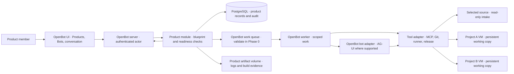
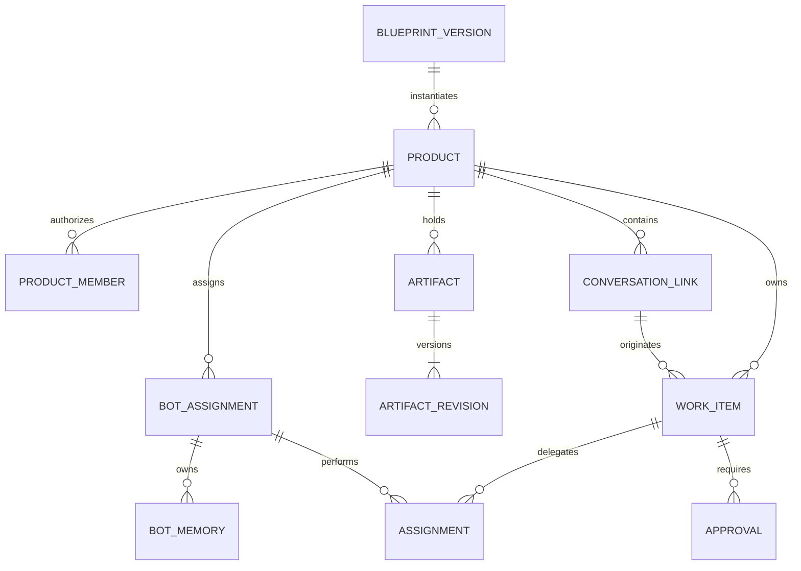
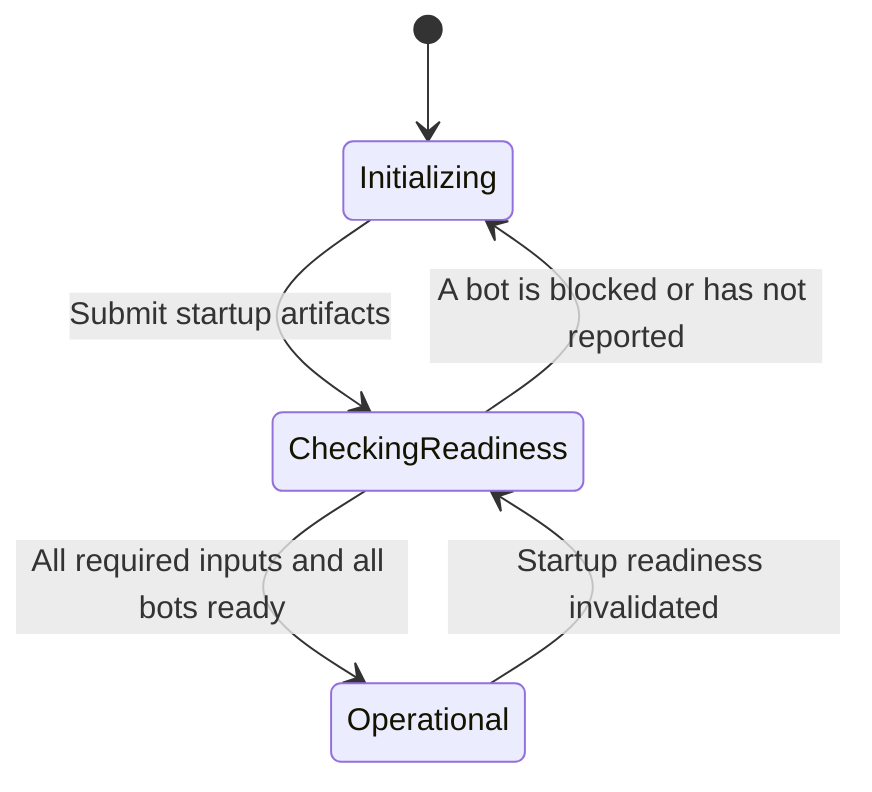
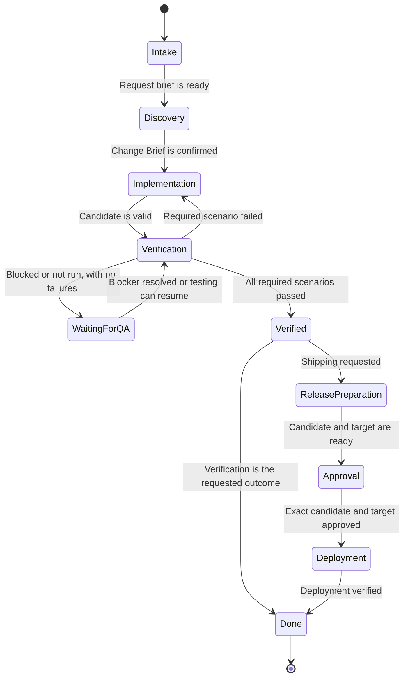
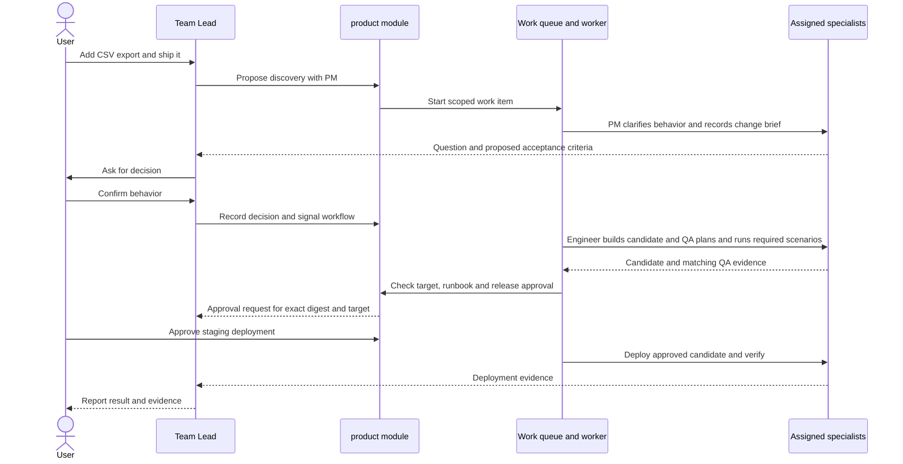

# OpenBot product operations platform

**Status:** Proposed architecture and implementation plan  
**First blueprint:** Software Engineering (SWE)  
**First release target:** A local product backed by a selected Git folder, with an approved release to a disposable staging target

## 1. Product model and scope

OpenBot is the application people use to run different types of businesses. A **blueprint** is a reusable, versioned operating contract. A **product** is an instance of one blueprint with its own people, bot assignments, artifact catalog, and work. A **conversation** is a surface inside a product. A **work item** is a durable request that can span conversations, handoffs, and approvals.

The existing prototype already has Projects beside Bots, a local folder picker, and project-linked conversations. Its project source is one saved folder or repository reference. The target design expands that into a typed artifact catalog and binds each product to a validated blueprint and its specialist roster. Native OpenBot chats are retained and linked to product records. The product UI owns the business structure. [Current deployment](docker-compose.md), [current exporter](openbot-integration.md).

Use one Docker Compose deployment per blueprint identity in a deployment environment. Each OpenBot installation hosts multiple business projects using its blueprint. Deploy distinct blueprints side by side with distinct Compose project names, app endpoints, and isolated configuration, networks, and persistent data. A fixture with a different roster, artifact vocabulary, and gates proves that another blueprint can provision a separate installation through the same runtime. Building a second business application, GitHub OAuth, and production deployment integrations are outside the first delivery.

## 2. Proposed stack and system boundaries

| Component | Decision and responsibility |
| --- | --- |
| OpenBot | Keep the pinned OSS OpenBot app and runtime. Reuse its authentication, bot execution, conversation APIs, tool and computer integration, approvals, and audit wherever they meet the acceptance cases. Reuse the existing Projects UI and folder picker for business project creation. Prefer documented extension points. Keep unavoidable upstream changes small and independently testable. [OpenBot source](https://github.com/CopilotKit/OpenBot) |
| Product module | Add only missing business semantics: blueprint validation and publication, product-scoped records, typed artifact contracts, startup readiness and policy checks. Start as a small module at the authenticated OpenBot boundary. Split it into a separate service only if the integration spike identifies a concrete deployment or isolation requirement. |
| PostgreSQL 17 | Reuse the existing instance with a separate product schema and database role. Store business records, artifact metadata and revisions, and any approval or audit references needed to link existing OpenBot records. Apply product membership checks and row-level security to product tables using a non-owner application role. [PostgreSQL row security](https://www.postgresql.org/docs/17/ddl-rowsecurity.html) |
| Work execution | Evaluate the pinned OpenBot queue and worker against SC-014 first. If the native path falls short, integrate a maintained framework behind the product module as an in-process library or private service in the blueprint deployment. Keep OpenBot chat, policy checks, and work items as the product boundary. [OpenBot routines](https://github.com/CopilotKit/openbot/blob/main/docs/routines.md) |
| JSON Schema | Use Draft 2020-12 for blueprint manifests and artifact payloads. Keep validation and reference checks in the product module and reuse them in the existing blueprint CLI. Reject unknown roles, tools, artifact types and invalid route references before publishing. [JSON Schema 2020-12](https://json-schema.org/draft/2020-12) |
| AG-UI and MCP | Use AG-UI at the OpenBot agent boundary when invoking a compatible agent. Use approved MCP connectors for typed tool calls where applicable. The product module authorizes each action and resolves artifact references before handing them to the OpenBot/tool adapter. [AG-UI](https://docs.ag-ui.com/introduction), [MCP authorization](https://apps.extensions.modelcontextprotocol.io/api/documents/authorization.html) |
| Git and project VMs | Use a local Git folder as the first source connector. Each Docker Compose deployment starts its own OpenBot app and services. Initialization of each SWE project provisions its own dedicated, persistent VM. Create a writable clone inside the VM and use a separate worktree per engineering attempt. The project’s authorized bots share the VM. Containers inside the VM can isolate individual jobs. Verify native OpenBot reuse and maintained open-source VM provisioning options in the integration spike. Keep test logs and build manifests in a product-scoped artifact volume behind the product module. [Git worktree](https://git-scm.com/docs/git-worktree.html) |
| Release adapter | Start with a disposable local staging service and a versioned release manifest. The adapter consumes an approved artifact digest and target, then records deployment and smoke-test evidence. Use a product’s existing CI/CD through a supported connector when it meets the release contract. Forgejo Actions is an OSS option for products that need a self-hosted CI runner. [Forgejo Actions](https://forgejo.org/docs/latest/user/actions/quick-start/) |

**OSS dependency gate.** The current Compose integration requires CopilotKit Intelligence configuration, and model inference also has its own provider. In Phase 0, verify chat, agent invocation, and tool execution on the pinned OpenBot revision and record exactly which capabilities require Intelligence. Keep those calls behind the OpenBot adapter. Inventory each required dependency, its license and its self-hosting path. Prefer verified OSS options for inference and any capability that requires a hosted service. Record gaps and get explicit agreement before treating a non-OSS service as required. A hosted dependency still in use must be disclosed in the pilot results. [Current Compose requirements](docker-compose.md), [OpenBot product documentation](https://www.copilotkit.ai/openbot).



The UI sends requests and renders work state. Models propose actions. The product module authorizes and schedules them. Activity workers perform side effects and report evidence. The Team Lead collaborates with the user in the product conversation. It uses existing evidence to surface gaps, explain trade-offs, and ask for the decisions that specialists need.

### Customization decision rule

1. Use native OpenBot configuration and supported interfaces wherever they meet the requirements.
2. Evaluate existing purpose-built skills and maintained OSS components through supported extension points. Reuse the product’s existing source, documentation, CI/CD, and metrics systems through supported integrations.
3. Apply this rule to every capability. Choose the smallest maintainable change that passes its acceptance checks. Limit custom glue to verified gaps and document the requirement, the evidence for the gap, and an upgrade or removal path for any new service or upstream patch.

## 3. Data model

| Record | Required data and invariants |
| --- | --- |
| `BlueprintVersion` | Blueprint key, version, content digest, role definitions, artifact schemas, routes, gates. Published versions are immutable. |
| `Product` and `ProductMember` | Product ID, name, pinned blueprint version, lifecycle state, user roles. Product identity is independent of the source path. Projects in the same installation can point to the same source with isolated records and permissions. |
| `BotAssignment` | Product ID, blueprint role key, OpenBot bot reference, status, and tool grants. Exactly one Team Lead assignment per active product. A runtime bot may be reused only if the adapter can enforce per-invocation product scope. |
| `Artifact` and `ArtifactRevision` | Product ID, type key, schema version, owner, typed payload, source reference, provenance, verification status and timestamp. Store content hashes or external revisions when the connector supplies them. No credentials in artifact payloads. |
| `BotMemory` | Project and bot assignment, current guidance, source feedback reference, and revision history. Retrieve relevant current guidance for the active assignment. |
| `ConversationLink` | Product ID and OpenBot conversation ID. Creating a product does not require a conversation. A conversation under a product defaults to its Team Lead and can optionally include other assigned participants. |
| `WorkItem` and `Assignment` | Product and blueprint version, origin conversation, objective, current stage, assignee, attempt, requested action, input artifact revisions and output references. Work items survive chat and service restarts. |
| `Approval` and `AuditEvent` | Actor, product, work item, action, target, artifact digest, policy version, outcome, and timestamp. An approval is valid for its exact action and inputs. |

Use PostgreSQL foreign keys with `product_id` in references between product records. Every read, write, work dispatch and tool invocation resolves the product from trusted server context. Request payloads and bot output cannot supply a new authorization scope.



### Blueprint authoring contract

The manifest declares `key`, `version`, `teamLeadRole`, `roles`, `artifactTypes`, `actions`, `routes`, and `workflows`. Together these form a declarative business model. A role defines an agent template and allowed actions. An artifact type defines its meaning, schema, valid states, relationships, owner and resolution adapter. Action inputs and outputs declare which roles consume and produce each type. A route maps the requested outcome and project evidence to an applicable published workflow. The Team Lead asks about ambiguous goals in discovery. For a clear goal with no matching workflow, it proposes a temporary workflow using the same phase and action contracts. A workflow defines its start and terminal phases, the role and action contract for each phase, and transition conditions. Action contracts declare inputs, outputs, result statuses, and required evidence.

Render the same definitions for product members and supply the applicable definitions to the bots producing or consuming records. For example, a Candidate identifies the increment and its source revision, and QA Evidence references that exact Candidate and the Change Brief it was checked against. Validate records and their references before accepting a handoff. A failed validation returns the specific field or reference to correct.

Example excerpt of the proposed SWE contract. The implementation will ship complete JSON Schema files and an executable manifest.

```yaml
key: software-engineering
version: 1.0.0
teamLeadRole: team-lead
roles:
  team-lead: { agentTemplate: team-lead, actions: [triage, clarify, delegate, report] }
  pm: { agentTemplate: product-manager, actions: [discover, prioritize] }
  engineer: { agentTemplate: software-engineer, actions: [implement] }
  qa: { agentTemplate: quality-engineer, actions: [verify] }
  release: { agentTemplate: release-engineer, actions: [prepare-release, deploy] }
artifactTypes:
  source-code: { schema: schemas/source-code.json, owner: engineer }
  change-brief: { schema: schemas/change-brief.json, owner: pm }
  candidate: { schema: schemas/candidate.json, owner: engineer }
  test-plan: { schema: schemas/test-plan.json, owner: qa }
  qa-evidence: { schema: schemas/qa-evidence.json, owner: qa }
  release-runbook: { schema: schemas/release-runbook.json, owner: release }
  release-target: { schema: schemas/release-target.json, owner: release }
  deployment-evidence: { schema: schemas/deployment-evidence.json, owner: release }
actions:
  implement:
    role: engineer
    requires: [source-code, change-brief]
    checks: [source-readable, baseline-resolved, workspace-writable]
    produces: [candidate]
  verify:
    role: qa
    requires: [candidate, change-brief]
    checks: [candidate-checkout-resolves, required-scenarios-present]
    produces: [test-plan, qa-evidence]
  deploy:
    role: release
    requires: [candidate, qa-evidence, release-runbook, release-target]
    checks: [qa-passed-for-candidate, target-reachable]
    approval: [candidate-digest, target-id]
    produces: [deployment-evidence]
```

### SWE artifacts and readiness

| Artifact type | Minimum payload | Needed when |
| --- | --- | --- |
| Source code | Connector and folder reference. Resolved Git revision and access evidence are recorded by the adapter. | Required at product creation. Engineering checks access and resolves a baseline before work. |
| Product direction | Product goals, priority decisions, and optional metrics references | PM can create it during discovery |
| Change brief | Requested behavior, scope, acceptance criteria and decision references | Before implementation |
| Engineering practices | Document reference or structured test and build commands from a trusted product configuration | Required only where the selected action declares it |
| Candidate | Source reference, base commit, candidate commit and optional build digest | Before verification |
| Test plan | Candidate and Change Brief revisions, required scenario IDs, prerequisites, steps, and expected results | Before running verification |
| QA evidence | Candidate, Change Brief, and Test Plan revisions, environment, per-scenario statuses and observations, evidence, pass percentage, and overall outcome | Before deployment. A changed candidate or brief requires fresh verification. |
| Release runbook and target | Deployment and rollback procedure, environment, adapter configuration and approver policy | Before deployment |
| Deployment evidence | Candidate digest, target, external deployment ID, smoke result and rollback reference | Before reporting a release as complete |
| Product metrics | Metric definition, source reference, observation window and timestamp | When evaluating an outcome that depends on metrics |

The blueprint provisions the exact bot roster and declares mandatory initialization inputs, recommended inputs, and startup checks per bot. SWE requires an existing source location. Initialization can also capture available CI/CD links, test and live environments, documentation, and requirements. The same artifact can support several bots, and each bot checks it with its own scoped access.

After input submission, each provisioned bot returns a readiness report with the artifact revisions checked and evidence or a blocker. OpenBot opens operational work only when all mandatory inputs are present, the required execution workspace is ready, and every provisioned bot has a current Ready report. The Team Lead asks the owner for specific missing or unusable inputs and explains which readiness checks they affect. If a startup binding changes, invalidate the dependent reports and pause new operations until the affected bots pass again.

Once the product is Operational, check action-specific prerequisites separately. A missing deployment target blocks deployment while leaving other eligible work available if the blueprint does not require that target at startup.



## 4. Execution and integration contracts

1. The user opens a product and sends a message to its Team Lead. OpenBot resolves the conversation's product and signed-in actor. The product module supplies the blueprint digest, assigned roles, permitted actions, and references the actor may access.
2. The Team Lead returns a typed proposal such as `ask_user`, `reply`, or `delegate(roleKey, actionKey, artifactRevisionIds)`. The service validates the proposal against the versioned contract. Failed checks produce a structured blocker with an artifact or permission to resolve.
3. On accepted delegation, persist the work item and dispatch it through the existing OpenBot queue with a stable work ID. Verify recovery if persistence succeeds before dispatch. If the integration needs an external workflow engine, use an atomic outbox and a stable workflow ID. The worker rechecks policy before executing and uses a stable idempotency key for each effect. Keep credentials and full artifacts out of workflow history.
4. The assigned bot works only on the artifacts and workspace granted for that assignment. Its result uses a status declared by the action, such as `succeeded`, `needs_input`, `blocked`, or `failed`, with the required artifact revisions and evidence. The product module validates the result and supporting evidence against the pinned workflow before applying a transition. It records the previous and next phase and rejects duplicate transitions, stale evidence, and disallowed phase changes. For QA, it verifies the pass percentage using all required scenarios as the denominator. Failed scenarios route to rework. Blocked or unrun scenarios keep verification pending when there are no failures. All required scenarios must pass before release preparation can proceed.
5. The Team Lead posts status and follow-up questions to the originating product conversation. Record each consequential question and the work that depends on its answer. Pause dependent actions while independent authorized work can continue. An authorized reply records the decision and signals the existing work item. Release approvals follow the separate approval policy. Cancellation stops future steps and records any completed external effects. If an external outcome is uncertain, reconcile by its execution ID before retrying.

Persist the selected workflow reference or the validated temporary workflow with the work item before dispatch. Apply the same validation and execution path to both. The Team Lead records the source and rationale for applicable practices in a temporary plan. For SWE, NIST’s SSDF is an example source for secure development practices that can be integrated into the project lifecycle. [NIST SP 800-218](https://csrc.nist.gov/pubs/sp/800/218/final)

Compare LangGraph’s persisted checkpoints and event streaming with self-hosted Temporal’s durable execution and workflow history. Evaluate n8n’s execution history and retries only if the intended packaging and use satisfy DC-003 and its license terms. OpenBot’s documented LangGraph bot integration is a candidate for reuse at the agent boundary. The integration spike must separately verify end-to-end workflow recovery and visibility on the pinned revision. Correlate engine execution IDs and attempt history with OpenBot work items while keeping operator access scoped to the project. [OpenBot source](https://github.com/CopilotKit/openbot) · [LangGraph persistence](https://docs.langchain.com/oss/python/langgraph/persistence) · [Temporal documentation](https://docs.temporal.io/) · [n8n executions](https://docs.n8n.io/build/understand-workflows/understand-executions/view-all-executions.md) · [n8n license](https://github.com/n8n-io/n8n/blob/master/LICENSE.md)

The SWE feature workflow routes QA outcomes as follows. Each transition still checks the required records and permissions.



When preparing an invocation, resolve memory using the project and bot assignment. Supply relevant current guidance alongside the configured skills and authorized MCP tools. Record feedback-driven updates with their source and preserve superseded revisions. Apply workflow validation and tool authorization to every action. For FR-029 through FR-031, first evaluate native OpenBot memory and existing configuration. Also evaluate whether a purpose-built feedback skill can use supported memory or a maintained OSS backend for the required guarantees. Use SC-011 to verify persistence, isolation, corrections, and compatibility with skills and MCP. Add only the integration needed to cover verified gaps.

Resolve each chat domain view from the pinned blueprint, bot role, and authorized project record. Bind the view to the work item and run so live execution updates and the final report appear in the same place in the conversation. QA renders progress from recorded scenario states and the final verdict from validated QA Evidence. Evaluate AG-UI as the baseline protocol for view state under DC-004. Use state snapshots to initialize and resynchronize the view and state deltas for incremental updates. Build the stream from the authorized projection of recorded workflow state and filter both snapshots and deltas before sending them. The blueprint describes which fields and details appear in each role’s view. OpenBot renders them through reusable chat components. Verify the existing OpenBot integration and protocol conformance against SC-012 before adding custom integration. [AG-UI state management](https://docs.ag-ui.com/concepts/state) · [AG-UI source and license](https://github.com/ag-ui-protocol/ag-ui)

Initial internal API surfaces:

| Endpoint | Responsibility |
| --- | --- |
| `GET /blueprints`, `POST /blueprints/:key/versions` | List published versions and validate/publish an immutable version |
| `POST /products`, `GET /products/:id` | Instantiate a blueprint, create the role assignments and attach the initial folder |
| `GET /products/:id/artifacts`, `POST /products/:id/artifacts` | List typed artifacts and add validated artifact revisions |
| `POST /products/:id/conversations` | Open a native OpenBot conversation and persist its product link |
| `POST /products/:id/work-items`, `GET /work-items/:id` | Accept an idempotent request and expose status, assignments, evidence and blockers |
| `POST /work-items/:id/inputs`, `POST /work-items/:id/approvals` | Submit structured decisions with actor and expected version checks |



## 5. Use cases and acceptance

| Use case | Actor and starting condition | Main path and alternate outcome |
| --- | --- | --- |
| UC-01 · Set up a product | A product owner has a local Git folder | Choose SWE, name the product, and select the folder. OpenBot creates role assignments and shows artifact readiness. If the folder cannot be resolved, the owner can correct the binding before source-dependent work starts. |
| UC-02 · Discover what to build | A product member opens the Team Lead with an idea or a question | The Team Lead brings in the PM, who uses available product context and asks focused questions. The result is a recommendation or a confirmed change brief. A recommendation can close without engineering work. |
| UC-03 · Build and verify | A confirmed brief and readable source exist | Engineering builds a candidate. QA checks it against the brief. A failed check produces evidence and returns the item for revision. A changed candidate starts a new verification attempt. |
| UC-04 · Release an increment | A verified candidate is ready for staging | The Release Engineer prepares the release. The workflow verifies the target and runbook, waits for approval, deploys, and records smoke results. An unavailable target blocks the deployment. A failed smoke test follows the product's rollback policy. |
| UC-05 · Resume or inspect work | A product member reopens the product after a pause or restart | The work view shows the latest assignment, evidence, and pending decision. The member can supply input in the originating conversation or review the approval from the work view. |

### Functional and operational requirements

| ID | Requirement and observable acceptance |
| --- | --- |
| FR-01 | Publish a versioned blueprint. Invalid role, artifact, tool, schema or route references fail validation. Existing products keep their pinned version after a new version is published. |
| FR-02 | Provision a SWE product from the catalog. The new project appears as Initializing with its exact roster. Submit the local source folder and any available supporting artifacts, inspect each bot's readiness report, and verify that operational work opens only after the project VM and every bot are ready. |
| FR-03 | Open two projects in one installation and talk to their Team Leads. Each uses its own project roles, history, and artifacts. |
| FR-04 | Ask for a product recommendation. PM can start with available artifacts and ask follow-up questions in the same conversation. The request reaches engineering only after the relevant action checks pass. |
| FR-05 | Ask for a small software change. Engineering produces a candidate, QA records evidence for that exact commit, and a failed QA check routes back for revision. |
| FR-06 | Request a release. A missing target produces a blocker. With a target, the workflow waits for approval tied to the candidate and target. A changed candidate requires fresh verification and approval. |
| FR-07 | Inspect product work. The UI shows current assignee, status, missing artifacts, decisions, and evidence links. Archiving a product blocks new work and preserves existing records. |
| FR-08 | Install a second blueprint fixture with different role and artifact names. Instantiate it and run a supported request with the same product module and worker. |
| NFR-01 | Cross-product reads, writes, artifact references and tool calls are denied even when the caller knows the other product's IDs. Test two projects in one installation using the same blueprint and bot definition. |
| NFR-02 | Restart API and worker during a pending approval. Work resumes from the recorded state. Duplicate events do not duplicate a checkout, artifact publication, or deployment. |
| NFR-03 | Import the working copy from the approved source root with read-only access. Restrict execution to the assigned project VM. Prevent path traversal, symlink escapes, arbitrary outbound access, and access to host credentials. |
| NFR-04 | Correlate user request, delegation, tool effect, approval, candidate and release evidence by IDs. Logs and activity inputs contain references rather than raw credentials. |
| NFR-05 | Back up product records, workflow persistence, and the artifact volume. Restore them into a clean local deployment and reconcile any in-progress work before re-enabling execution. |
| NFR-06 | Restart OpenBot and reconnect to the same project VM with local edits and outputs intact. Surface a blocker when reconnection fails and hold VM-dependent work until it recovers. |

## 6. Implementation order and exit criteria

| Phase | Build | Exit criterion |
| --- | --- | --- |
| 0. Integration spike | Pin the OpenBot commit. Map each requirement to supported configuration, a suitable skill or OSS integration, or a documented gap, with the acceptance checks for the proposed path. Prove product scope, bot invocation, tool calls, and the durability and observability checks in SC-014. Record which orchestration path meets them and what integration it needs. Inventory licenses and the Intelligence and model dependencies. | A test request completes through the proposed bridge. The reuse matrix documents the evidence for every custom module, upstream patch, or new service. Approve exceptions before implementation. |
| 1. Blueprint contract | Extend the current CLI with publish-time semantic validation. Author the SWE manifest and artifact schemas. Add invalid fixtures and a minimal non-SWE contract fixture. | FR-01 passes. Both blueprints validate without domain-specific changes to the CLI. |
| 2. Product workspace and initialization | Add product module tables, membership enforcement, the workspace UI, artifact revisions, role and project VM provisioning, per-bot readiness reports, and the operational startup gate. Reuse the folder picker. Backfill existing projects and conversation links with stable IDs and verify counts before switching writes. | FR-02 and FR-03 pass. Create a second SWE project in the running SWE app and verify separate VMs, isolated records, and per-project readiness. Verify repeat provisioning leaves one SWE app and a distinct blueprint’s app can operate independently on the same host. Existing conversation links resolve. |
| 3. Delegation and evidence | Reuse the native queue and worker if the spike passes. Add the Team Lead decision contract, including targeted questions, waiting actions, and resuming from authorized replies. Add workflow inference and temporary workflow validation, PM discovery, isolated Git execution, and QA. Verify both workflow paths against SC-013. Use the orchestration path selected under DC-006. Build the product work view with blocker and evidence states. | FR-04, FR-05 and NFR-01 through NFR-03 and NFR-06 pass in a local demo, including a restart and a failed QA run. |
| 4. Staging release | Implement a disposable target, digest-bound approval, deployment reconciliation and smoke checks. Add audit and backup/restore checks. | FR-06, FR-07, NFR-04 and NFR-05 pass. No deployment occurs before the required approval. |
| 5. Reuse proof | Run the non-SWE fixture and add a supported request that uses its own artifact vocabulary. | FR-08 passes in its own installation using the same service definitions and UI. |

First implementation change: Phase 0 and a small contract fixture. Keep the current project UI usable while proving the native OpenBot integration and the boundary where product scope is enforced.
