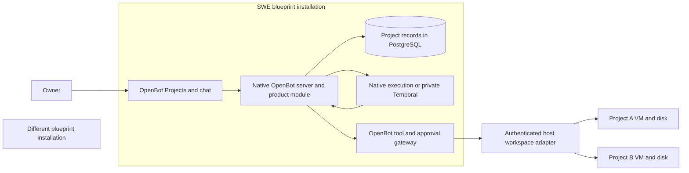

# Implementation Plan: Business Operations Platform

**Feature**: `001-business-operations-platform` | **Branch**: `main` | **Date**: 2026-11-10 | **Spec**: [spec.md](spec.md)

## Summary

Use one OpenBot installation per blueprint identity and allow multiple projects within it. Extend the existing Projects and chat integration with a small product module that owns versioned blueprints, project readiness, workflow rules, and project permissions. Give each SWE project a persistent host-managed Lima VM. Keep OpenBot as the user interface and tool policy boundary. Test native execution first and use self-hosted Temporal if the native worker cannot meet the durable execution and observability checks. [Research](research.md)

## Technical Context

| Area | Plan |
| --- | --- |
| Language | TypeScript on Node.js 22+ for the existing CLI and optional Temporal worker. TypeScript on Bun and React for the pinned OpenBot server and app overlay. |
| Dependencies | Pinned OpenBot revision, existing tenant exporter, PostgreSQL 17 with pgvector, Docker Compose, Lima, Git, AG-UI 1.0 state events, and a compatible schema validator. Temporal is the planned fallback for business workflow execution. |
| Storage | PostgreSQL for projects, blueprints, records, memory, and work history. Separate VM disks for source and build state. Existing artifact storage for logs and results with project checks on access. |
| Platform | Compose on macOS or Linux with a reachable Lima provider on the host. Probe each supported host combination before declaring it supported. |
| Testing | Existing Node tests, blueprint contract fixtures, pinned OpenBot integration tests, and the pilot checks in [quickstart.md](quickstart.md). |
| Pilot targets | Two concurrent SWE projects with separate VMs and a distinct blueprint installation on the same host. Four of five owners complete the SC-001 setup flow within five minutes. Record image downloads separately and run the timed scenario on a prepared deployment. |
| Constraints | Local source-folder intake, disposable staging target, explicit permissions and release approvals, one installation per blueprint identity, and minimal custom code under DC-001 through DC-006. |

## Constitution Check

The repository constitution contains the unfilled template. The pre-design check found no adopted constitution rules. The spec’s delivery constraints apply throughout the design. Post-design review found the planned custom boundaries limited to project scope and lifecycle, blueprint validation, guarded VM access, and integration gaps in workflow execution and chat. The implementation must verify those gaps before introducing replacement services. Intelligence licensing and deployment are an explicit DC-003 pilot check.

## Architecture

OpenBot resolves project scope from the authenticated conversation or work item. Team Lead proposes a published workflow or a temporary plan. The product module validates and persists the plan, grants, and artifact revisions before dispatch. Workers execute authorized steps and return structured evidence. The product module projects durable state into the work view and chat. Release effects remain bound to the approved candidate and target.

## Project Structure

| Location | Responsibility |
| --- | --- |
| `src/`, `schemas/`, `bin/` | Extend blueprint validation, tenant export, and deployment identity checks. |
| `blueprints/` | Add the versioned SWE operating contract and a distinct proof fixture. |
| `deploy/openbot/team-intake/` | Reuse project folder and chat integration. Adapt the prototype to stable project IDs, typed records, and readiness. |
| `deploy/openbot/product/` (planned) | Product routes, migrations, project authorization, workflow and memory storage, and chat projections. |
| `deploy/workspace-provider/` (planned) | Host-side Lima adapter. |
| `deploy/workflow/` (conditional) | Private Temporal worker and deployment configuration if the native path misses SC-014. |
| `docker-compose.yml`, `test/` | Add required services and configuration to the existing deployment and validate supported startup paths. |

## Implementation sequence

| Phase | Deliverable and exit check |
| --- | --- |
| 0. Research and integration proof | Build the pinned OpenBot baseline. Verify chat/tool hooks, exact AG-UI package versions, Intelligence requirements, native workflow recovery, and host VM capabilities. Use SC-014 to decide the execution path. [Research](research.md) |
| 1. Contracts and deployment identity | Add immutable blueprint versions, typed records and deterministic workflow validation. Verify repeated install for one key and separate stacks for two keys. |
| 2. Projects and readiness | Add stable project IDs, membership, per-role readiness reports, and persistent VM bindings. Backfill existing conversation associations by legacy owner and source group before switching writes. Prove two new projects from the same folder stay separate. |
| 3. Workflow execution | Add Team Lead routing, PM clarification, specialist dispatch, guarded temporary workflows, and correlated attempt history. Test recovery, denied handoffs, and duplicate effects. |
| 4. Evidence, memory, and chat | Add candidate and QA contracts, feedback revisions, and role views. Exercise authorized live state, reconnect, stale results, failed QA, and rework. |
| 5. Release and pilot | Add candidate/target-bound approval and disposable staging adapter. Test reconciliation and backup/restore, complete pilot timing and blueprint reuse proof. |

## Capability coverage

| Spec requirements | Planned path and proof |
| --- | --- |
| FR-001, FR-004, FR-016, FR-020–021, FR-026, FR-034 | Extend the exporter/validator with versioned domain and workflow contracts. Test valid SWE and distinct blueprint, plus wrong types and invalid references. SC-004, SC-007. |
| FR-002–003, FR-005, FR-015, FR-017–019 | Reuse the project UI and folder picker, add project identity, artifacts, and persisted readiness. SC-001, SC-004, SC-006. |
| FR-022–024 | Host-managed VM with verified read-only source import and independent disk. SC-004, SC-008. |
| FR-006–009, FR-011, FR-025, FR-027, FR-035–036 | Native chat and workflow adapter with deterministic validation and a durable history. SC-002, SC-005, SC-009, SC-013, SC-014. |
| FR-010, FR-012–014, FR-028 | Candidate and QA records, approved staging release, and effect reconciliation. SC-002, SC-003, SC-005, SC-010. |
| FR-029–031 | Evaluate native learning and memory. Use a scoped feedback action and PostgreSQL revisions if native scoping or corrections fall short. SC-011. |
| FR-032–033 | Reuse chat and AG-UI state with authorized per-role projections. SC-012. |

## Phase 1 design artifacts

- [Data model](data-model.md)
- [Blueprint and workflow contracts](contracts/blueprint-workflow.md)
- [OpenBot project and chat contracts](contracts/project-chat.md)
- [Workspace provider contract](contracts/workspace-provider.md)
- [Pilot validation guide](quickstart.md)
