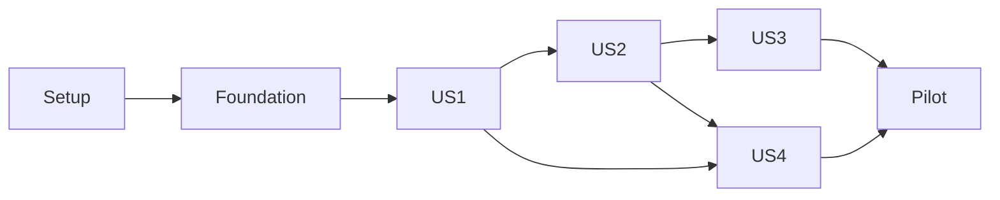

# Tasks: Business Operations Platform

**Input**: [Spec](spec.md), [plan](plan.md), [research](research.md), [data model](data-model.md), [contracts](contracts/), and [pilot validation guide](quickstart.md).

Paths are relative to the repository root. Paths introduced by these tasks are proposed implementation locations. A `[P]` task can run alongside the tasks named in the parallel examples once its prerequisites are ready. The checkpoints exercise the acceptance scenarios in the spec. The optional Temporal branch is part of a single task so either verified execution path can complete it.

**Current status (2026-11-25):** 39 of 48 tasks are marked complete; 9 remain open. The owner accepted the separately licensed Intelligence service for the pilot; this does not establish an open-source replacement. Completed component tasks do not imply pilot completion. The root Compose stack includes the private Temporal engine and worker, and fixture coverage exercises persisted decisions, retries and recovery; a legitimate specialist workflow through the normally provisioned app remains unverified. Actual OpenBot MCP invocation remains an acceptance gap. T045–T048 track cross-cutting work overlapping the reopened tasks. Host source intake uses descriptor-relative traversal with no-follow opens; fixture checks cover folder/Git baselines and a swapped directory path. Python 3 is a host-provider requirement. See [pilot results](pilot-results.md) for evidence and limitations. `npm run check` passed on 2026-11-25 (TypeScript build, blueprint validation, and all 122 unit tests). On 2026-11-25 the local SWE workspace readiness project subsequently reached Operational with five current specialist readiness reports and a Ready Lima VM/source baseline. Small direct and streaming Qwen requests succeeded, but a real Team Lead project conversation still failed because LM Studio rejected the full prompt as larger than the loaded model context. Gemma remained unavailable under LM Studio's resource guardrail. This updates the earlier app-readiness observation but does not close the five-owner timed trial or full setup acceptance. Docker socket access was denied in the current coding session, so no new live Compose checks were claimed.

## Phase 1: Setup

**Purpose**: Establish the current baseline and record evidence for the reuse decisions.

- [X] T001 Run `npm run check` from `package.json`, check the pinned OpenBot build and Compose startup from `deploy/openbot/upstream.json` and `docker-compose.yml`, and record the exact revision, supported chat and tool hooks, AG-UI package version, and any blocked runtime checks in `specs/001-business-operations-platform/research.md`.
- [X] T002 [P] Run the host Lima probe from `specs/001-business-operations-platform/quickstart.md`, verify guest persistence and reachability from Compose on the target host, and record the verified host profile and guest image digest in `deploy/workspace-provider/README.md`.
- [X] T003 Use a minimal disposable workflow probe to evaluate native OpenBot orchestration for a persisted decision wait and an interrupted effect under SC-014. Evaluate the pinned Intelligence requirement and licensing under DC-003. Record the reuse decision, exact observed gaps, and supported pilot dependencies in `specs/001-business-operations-platform/research.md` after T001. The native-dispatch probe selected Temporal; the owner explicitly accepted separately licensed Intelligence for the pilot on 2026-11-22. Full workflow acceptance remains T043.

## Phase 2: Foundation

**Purpose**: Provide the shared blueprint, installation, project identity, and permission boundaries.

- [X] T004 [P] Extend `schemas/blueprint.schema.json` and `src/types.ts` for roles, initialization checks, artifact schemas, action results, workflow definitions, and role views per `specs/001-business-operations-platform/contracts/blueprint-workflow.md`. Preserve compatibility with existing blueprint files.
- [X] T005 [P] Define the installation, immutable blueprint version, project membership, assignment, conversation, and artifact tables in `deploy/openbot/product/migrations/001-projects.sql`. Use project-qualified references and generate project IDs independently of source paths.
- [X] T006 [P] Implement the planned `blueprint provision` command in `bin/blueprint.ts` and blueprint-keyed deployment in `bin/openbot-compose.ts` and `docker-compose.yml`. Serialize creation, identify the existing deployment on repeat, and allocate distinct app ports, data, network, and VM namespaces for distinct keys. Retain the installed key across version upgrades and preserve native environment preflight.
- [X] T007 Implement semantic validation in `src/schema.ts` and publication/export in `src/blueprints.ts` and `bin/blueprint.ts` using T004 and T005. Enforce publisher authorization and reject unresolved references, unreachable terminal outcomes, overlapping transition conditions, and changed content under a published key/version. Preserve CLI validation and tenant export.
- [X] T008 Implement authenticated project lookup, membership checks, permission-filtered artifact resolution, structured errors, and mutation idempotency in `deploy/openbot/product/access.ts` and `deploy/openbot/product/store.ts` using T005. Derive project and actor from native context, including bot callbacks. Signed direct, group, and leased handoff bindings and scoped artifact reads are verified.
- [X] T009 Integrate the product module with the pinned server, migrations, and governed tool path in `deploy/openbot/team-intake/install.ts` and `deploy/openbot/server.Dockerfile` after T007–T008. Preserve the existing chat and tenant entry points. Read-only project context, memory, and artifact tools use the native per-turn and signed callback boundaries; workspace tool authorization is implemented in T014, while workflow handoffs remain T025.

**Checkpoint**: Invalid blueprints fail publication. A blueprint key resolves to one installation. Shared data access goes through authenticated project scope.

## Phase 3: US1 — Provision and initialize a business (P1)

**Goal**: Create a SWE project with its own team, source baseline, and VM. Show what must be fixed before it can operate.

**Independent validation**: Create a project from an accessible local folder. Introduce a missing or unusable prerequisite and verify that Team Lead remains available for setup while operational work is blocked. Correct the issue and verify that all mandatory artifacts, the VM, and current bot reports are ready before operations open. Use SC-001 and SC-006.

- [X] T010 [P] [US1] Define Team Lead, PM, Engineering, QA and Release Engineering as the SWE operating roster, with role views, skills, tools, startup checks, workspace requirement and typed artifacts in `blueprints/software-development/blueprint.json` and `blueprints/software-development/artifacts.json`. Make source required and let the owner add the recommended inputs in FR-002.
- [X] T011 [P] [US1] Implement authenticated Lima ensure, health, and reconciliation operations in `deploy/workspace-provider/lima.ts` and `deploy/workspace-provider/server.ts`. Use a stable installation and project key, persistent guest disk, and isolated network. Return a blocker on provider failure and recover the existing VM after an uncertain create.
- [X] T012 [P] [US1] Implement bounded read-only local folder intake in `deploy/workspace-provider/source-import.ts` and `deploy/workspace-provider/source_snapshot.py`. Revalidate containment, preserve the selected committed Git baseline or snapshot a plain folder, reject escaping references, and return the verified guest revision and digest without changing the source. Python 3 traverses directory descriptors and opens every child without following symlinks; Git metadata is copied into a bounded temporary repository with external alternates and included configuration rejected before archive/bundle creation. Six source tests pass, including a directory moved and replaced with an outside symlink after its descriptor was opened; the snapshot retains the opened in-tree content, and hostile Git metadata tests reject external object alternates and included configuration. Project initialization and a real disposable Lima import/replacement probe pass; the five-owner trial and complete setup acceptance remain in T019.
- [X] T013 [US1] Implement project creation, artifact submission, per-project VM binding, Team Lead conversation creation, and project listing in `deploy/openbot/product/projects.ts` and `deploy/openbot/product/migrations/002-initialization.sql` after T010–T012. Reconcile retries using existing project and VM identities.
- [X] T014 [US1] Implement the guest action and reconciliation operations in `deploy/workspace-provider/actions.ts` and bind them to native role and tool grants in `deploy/openbot/product/workspace.ts` after T011 and T013. Match actor, project, assignment, and VM before dispatch. Hold dependent work when the VM is unavailable. Active-phase bindings are immutable and verified; the workflow dispatcher still needs to create them in T025. Approval-protected actions remain blocked until the release gate is available.
- [X] T015 [US1] Implement per-assignment readiness checks, persisted evidence and invalidation in `deploy/openbot/product/readiness.ts` after T013–T014. Invalidate affected reports when inputs or assignments change. Block operational handoffs, execution and release until every required check is current and ready. Raw project delegation remains blocked until typed workflow routing is connected.
- [X] T016 [US1] Implement `GET/POST /api/products` and `POST /api/products/:id/initialization` in `deploy/openbot/product/routes.ts` after T015. Return scoped setup reports, VM status and retryable blockers. The routes, idempotent creation, conversation visibility, and setup blocker response are verified against disposable PostgreSQL.
- [X] T017 [US1] Update the Projects page, folder selection and Team Lead setup experience in `deploy/openbot/team-intake/projects-route.tsx` and `deploy/openbot/team-intake/setup-form.tsx` after T016. Show the pinned version, role roster, mandatory and recommended inputs, progress and targeted setup questions. The application image builds and the project/context API is covered by disposable PostgreSQL checks; the timed owner trial remains T019.
- [X] T018 [US1] Backfill legacy owner/source conversation groups with stable project IDs in `deploy/openbot/product/migrations/003-legacy-projects.sql` and switch existing project-linked chats in `deploy/openbot/team-intake/setup-store.ts` after T016. Verify existing associations before switching writes and preserve independent identity for new same-folder projects. Verified private groups migrate automatically; owners can import selected private conversations or leave shared and unverifiable conversations in the previous-projects view. Selection persists, and legacy creation/setup writes are disabled with the product module enabled.
- [ ] T019 [US1] Run the setup acceptance scenarios in `specs/001-business-operations-platform/quickstart.md` after T017–T018, including a VM provisioning retry, missing and stale bot reports, and the timed owner setup check. Record evidence against SC-001 and SC-006. PostgreSQL and simulated-provider readiness checks pass, and the disposable Lima VM recovery and source replacement test passes on the current host. After readiness instruction and parsing fixes, five live Qwen specialists reported Ready against a real disposable Lima VM and verified source; the test used isolated turn persistence and synthetic source. On 2026-11-23 the optional workspace provisioner created a separate SWE project, supplied source, CI, test-environment, requirements and documentation artifacts, and provisioned a real Lima VM whose isolation and source revision checked Ready. On 2026-11-25 the provisioned SWE workspace readiness project reached Operational, with current Ready reports for all five specialists and a Ready VM/source baseline. This closes the app-level readiness gap for that project; however, small Qwen requests succeeded while the Team Lead project conversation exceeded LM Studio's loaded context length. The five-owner timed trial and remaining missing/stale/retry setup scenarios are unverified, so T019 remains open.

## Phase 4: US2 — Work through the product’s Team Lead (P1)

**Goal**: Turn a user’s requested outcome into an observable workflow with decisions, governed handoffs, verification, and role-specific views.

**Independent validation**: Start with one Operational project. Ask for an adoption recommendation, a feature, and a clear outcome with no published match. Verify selection and temporary planning, pause and resume a decision, follow live QA and its final result, and confirm scoped bot feedback survives restart. Use SC-002, SC-007, and SC-009–014.

- [X] T020 [P] [US2] Declare SWE discovery and feature delivery workflows, matching conditions, phase owners, retry rules, and mandatory release phase references in `blueprints/software-development/workflows.json`. Define the Change Brief, Candidate, Test Plan and QA Evidence contracts in `blueprints/software-development/artifacts.json` after T010.
- [X] T021 [P] [US2] Add work items, pinned run plans, attempts, transitions, pending decisions, dispatch intent and effect identities in `deploy/openbot/product/migrations/004-workflow.sql` after T005. Uniquely identify a phase occurrence and its stable operation key across retries.
- [X] T022 [P] [US2] Implement scoped bot feedback and correction history in `deploy/openbot/product/feedback.ts` and `deploy/openbot/product/migrations/005-feedback.sql` after T008. Reuse native assignment memory if it meets SC-011. Otherwise use the existing PostgreSQL store. Inject current authorized guidance alongside configured skills and MCP without changing permissions or workflow rules. Scoped storage, bot-submitted feedback, correction history, clarification, and reloading in a fresh server process are covered by PostgreSQL fixtures. A disposable Temporal test verifies a held workflow resumes after conflict clarification and injects the corrected guidance without the superseded guidance. A live Qwen bot read and correctly explained a resolved project-scoped correction through the native memory tool. Current guidance injection keeps the newest entries up to 20 entries/8,000 characters and signals omissions; the Team Lead memory description uses a 4,000-character cap. Workflow bot construction now uses OpenBot's native per-actor learned-skill resolver; user account tools and bot handoffs remain disabled. Unit checks cover memory bounds; the full suite passes 122 tests and the pinned server type-check passes. The project fixture verifies declared MCP refs are the only tools exposed, valid scope reaches the connector, and invalid scope is refused before connector execution. Live authorized MCP invocation with configured skills remains an acceptance item under T046.
- [X] T023 [US2] Implement Team Lead routing and clarification in `deploy/openbot/product/workflow-routing.ts` after T020–T021. Prefer the matching published workflow. Persist a validated temporary workflow with guidance references when no match fits, and explain unresolved inputs or permissions without changing the catalog. The Team Lead can inspect published processes, phases, roles and actions and save a validated pending plan or clarification from its project conversation. Validated temporary SWE plans can include the supported staging gate; tests reject bypass routes. A distinct temporary service workflow was pinned and executed through the disposable worker without changing the published catalog. A live Qwen Team Lead inspected the catalog and saved the matching published workflow, but its status wording was ambiguous even though it stated execution was pending. The native planning tool now returns and an integration assertion verifies the exact message that a saved plan has not started; idempotent replay returns the same run and status. When asked for an unsupported incident process, an initial live proposal misrepresented a clarification action; after prompt guidance, a retest explained the missing capabilities without saving a placeholder. Signed Team Lead binding authorization now runs inside the transaction on both creation and replay; unit and disposable PostgreSQL tests reject revoked bindings. Workflow requests, clarification questions and temporary-plan guidance are bounded before persistence. Live-model temporary planning and end-to-end execution remain acceptance items under T031 and T048.
- [X] T024 [US2] Implement the shared execution interface in `deploy/openbot/product/workflow-engine.ts` after T003 and T021. Use the native path if it meets SC-014. Otherwise wire the private Temporal service and worker in `deploy/workflow/worker.ts` and `deploy/workflow/compose.yml`. Support persisted waits, deduplicated dispatch, correlated attempts, and restart on the pinned run plan. The experimental overlay connects the scheduler and authenticated activity handler for built-in phases, including candidate-bound protected QA and scoped workspace actions. A disposable Temporal/PostgreSQL test verifies a decision recorded while the worker is stopped resumes on the pinned run without repeating a specialist turn or workspace effect. AG-UI remote declarations now use the native headless runner and scoped phase tools; a remote-declared specialist passed the disposable workflow fixture with simulated turn responses. A disposable AG-UI HTTP service now runs a remote-declared workflow through scoped middleware, output acceptance, retries and decision waits across worker replacement. A separate remote HTTP fixture also confirms an unavailable computer tool is refused while the scoped output tool runs once. The native headless turn runner also completed a scoped remote HTTP turn with isolated persistence and runner fakes; a live LM Studio model completed a built-in headless tool turn using the same isolated test infrastructure. A real remote model and full end-to-end recovery remain unverified.
- [X] T025 [US2] Implement typed bot requests and result acceptance in `deploy/openbot/product/actions.ts` after T023–T024. Recheck grants, readiness, artifact revisions, expected phase and attempt identity before transitions. Record invalid or stale outputs and make repeated results idempotent. Built-in specialist dispatch, immutable accepted results and rejection digests, result-bound decisions, and free-text clarification continuations have PostgreSQL and disposable Temporal fixture coverage. Results with competing revisions for the same output type are rejected. A live Qwen model completed one disposable service-project phase with an actual saved output and authorized evidence; earlier malformed, incomplete and invented results were held. Failed turns with no saved output or reserved workspace action follow the bounded blueprint retry policy, with durable lineage and a Temporal timer; blocked turns stop with an access-filtered reason. PostgreSQL checks cover replay, exhaustion and refusal after output or reservation, and both a Temporal test and a disposable OpenBot–Temporal stack cover worker replacement during the delay. SWE staging approval-gated transitions have disposable database coverage; full acceptance remains incomplete.
- [X] T026 [US2] Implement the PM brief and Engineering candidate handoffs in `deploy/openbot/product/feature-delivery.ts` after T025. Ask for consequential missing decisions, run authorized implementation in the assigned VM, and bind each candidate to the exact brief and source baseline. SWE output validation rejects empty or duplicate scenario IDs and empty expected outcomes; candidate checks bind the brief and workspace baseline and verify a clean guest commit. Specialists can ask sequential free-text questions and continue on the same occurrence, including across a worker restart. A live Qwen PM used the actual PM prompt to save a validated brief and the next Engineering attempt pinned that exact revision; its Team Lead input and workspace provider were fixtures. On 2026-11-23 a live Gemma PM retry against the configured local endpoint failed before generation because LM Studio refused to load the model due to insufficient system resources. Actual-model Engineering execution and ambiguity handling remain acceptance items under T048.
- [X] T027 [US2] Implement Test Plan and QA execution in `deploy/openbot/product/qa.ts` after T026. Persist scenario progress, validate every final result and its references, compute pass counts, and transition to rework, a wait, or verified according to the evidence. Append-only per-scenario progress is bound to the current plan, candidate, phase and workspace evidence; final reports must match it. QA also rejects a missing, withdrawn or digest-mismatched brief before accepting a plan or report. The project work view filters scenario progress by artifact access and shows the aggregate. A candidate-bound protected checkout passed disposable VM checks; PostgreSQL fixtures cover refusal of unsupported providers, failed-scenario rework, blocked-scenario retry and verified after an authorized decision. Live Qwen QA attempts against a simulated protected provider were held after confusing the candidate commit and artifact revision, requesting an unauthorized workspace tool, or claiming supplied scenarios were absent. Live QA and complete end-to-end execution remain acceptance items under T031 and T048.
- [X] T028 [US2] Implement work item create/read, decision resume, and assignment feedback routes in `deploy/openbot/product/work-routes.ts` after T022 and T025. Return attempts, blockers and timestamps to authorized actors and signal the same run on an authorized decision. Creation and feedback use existing routes and native tools; conversation-scoped reads return runs, attempts, dispatch states, decision options, rejection codes and visible feedback blockers. Authorized answers are committed with a durable signal intent and resume the original run, including after worker restart; the Projects page and originating chat list work and allow answering. Both views surface visible feedback conflicts; the originating chat also displays current attempts and held rejected results. The chat and Projects page show when the engine reports an uncertain action and expose recovery only to the authorized requester. Disposable PostgreSQL and Chrome fixtures verify state filtering, malformed or unavailable engine responses, revoked access, feedback and rejected-result messages, their removal after completion, and recovery controls. Known server-generated reasons now include uncertain and safely classified blocked outcomes such as staging blockers, approver rejection, the bounded retry limit, and invalid plan transitions; these appear as fixed messages only when all referenced run artifacts are visible. Arbitrary engine or model text remains hidden. On 2026-11-23 the pinned frontend and isolated Chrome fixture passed for structured role fields, QA progress, approval evidence, verified outcome and recovery controls. Full-stack acceptance remains T031.
- [X] T029 [US2] Implement authorized AG-UI snapshots and deltas in `deploy/openbot/product/chat-state.ts` after T027–T028. Filter each viewer’s state before generating deltas, recheck on reconnect or permission change, and bind updates to the original conversation and run. Implemented in `chat-events.ts` and the product routes: blueprint-defined role fields and QA progress stream as viewer-specific snapshots and replacement deltas from durable run records. PostgreSQL fixtures cover a second blueprint, reconnect, cross-run rejection, candidate and report access changes, conversation removal, and session revocation using OpenBot's uncached authentication guard. Browser-level acceptance remains T031.
- [X] T030 [US2] Mount blueprint-selected role views in the originating chat via `deploy/openbot/team-intake/install.ts` and render expandable QA scenarios, live progress, and the final verdict in `deploy/openbot/team-intake/domain-views.tsx` after T029. Reuse compatible native rendering and reload the same final evidence when the conversation is reopened. Direct and group project conversations mount selectable role views with structured fields, QA scenario details and decision controls. The pinned app builds and type-checks; an isolated headless Chrome fixture verified the QA view, scenario expansion, evidence and decision submission. Actual-model and full-stack browser acceptance remain T031.
- [ ] T031 [US2] Run the workflow, handoff, QA, feedback and reconnect scenarios in `specs/001-business-operations-platform/quickstart.md` after T030. Validate recoverable retries and persisted decision waits on both published and temporary runs using a disposable effect fixture. A disposable OpenBot–Temporal fixture verifies decision waits on both published and validated temporary workflows, plus a temporary retry after worker replacement, with pinned guidance and no repeated failed turn or workspace effect. The fixture was rerun successfully after correcting its workflow image binding. On 2026-11-25, a fresh run rebuilt the ordinary root Compose stack, restored a disposable Temporal database snapshot and replayed its decision wait in a separate Temporal instance and worker; resuming the restored product workflow then failed with a reset on the activity fixture status endpoint. Fixture logs also show a pending feedback conflict on the original activity path. The harness now captures logs on failure. Actual-model, fixture recovery regression and remaining end-to-end scenarios are open. Repeat the actual staging-effect proof in US3.

## Phase 5: US3 — Prepare and approve a release (P2)

**Goal**: Prepare a release with exact evidence, ask the designated human approver, and deploy once to a disposable target.

**Independent validation**: Begin from a verified candidate. Check that missing artifacts or stale evidence hold release, then approve the exact candidate and target and inspect its verified receipt. Interrupt the worker after the target accepts the deployment and confirm recovery leaves one outcome. Use SC-003, SC-005, and SC-014.

- [X] T032 [P] [US3] Add release proposals, candidate/target-bound approvals and effect receipts in `deploy/openbot/product/migrations/006-releases.sql` after T021. Persist the operation key and verification references.
- [X] T033 [P] [US3] Implement the disposable staging target adapter with lookup and reconciliation by operation ID in `deploy/openbot/product/staging-target.ts` after T024. Support a pilot fixture that commits the effect before its receipt is returned. The adapter and durable disposable fixture are verified independently; connecting approval and workflow execution remains T034–T036.
- [X] T034 [US3] Implement release preparation, authorized approval, stale evidence invalidation, deployment, and post-deployment verification in `deploy/openbot/product/releases.ts` after T027, T028, T032 and T033. Recheck approval before effect dispatch. Reconcile an uncertain result before retrying. Release target and runbook can now be supplied as optional project inputs; preparation has a preflight that revalidates the current candidate, source, brief, accepted same-run QA plan and evidence, target and runbook before the turn and before accepting its result. Disposable PostgreSQL checks reject stale QA, plan or brief, a changed baseline, a restricted target, another run's QA, a forged result digest and changed attempt inputs. Immutable proposals and authorized approvals bind the exact candidate and evidence; a staging adapter records an operation before dispatch, reconciles by operation ID and independently verifies its receipt. Disposable tests exercise these paths. The original requester can signal recovery from the project chat; PostgreSQL checks verify its run, requester, work permission and conversation binding. Published and temporary release fixtures both reconcile lost responses without repeating an effect. Full workflow acceptance remains incomplete.
- [X] T035 [US3] Wire Release Engineering and Team Lead summaries into the SWE release phases in `blueprints/software-development/workflows.json` and `deploy/openbot/team-intake/domain-views.tsx` after T030 and T034. Show the approver the candidate, target, evidence and decision. Report the verified outcome in the originating conversation. The chat displays approval evidence and the verified receipt; a disposable Chrome fixture verifies both approval and the final verified outcome. The Team Lead can inspect conversation-scoped run progress and authorized run-linked deployment evidence; PostgreSQL fixtures check access restrictions. A live Qwen Team Lead read and reported the simulated release target and receipt; an initial unsupported inference about checks led to clarified prompt guidance, and a retest omitted that inference. Full workflow acceptance with worker interruption remains T036.
- [X] T036 [US3] Execute the release and recovery scenarios in `specs/001-business-operations-platform/quickstart.md` after T035. Verify each negative release gate and a single staging outcome for the published and temporary workflow interruption scenarios. Disposable PostgreSQL fixtures reject withdrawn target and runbook inputs. The release-recovery Compose harness drove both a published and a temporary SWE workflow through the real Temporal worker to an approved deploy; the disposable staging service committed each effect and dropped its first response, the worker was stopped and restarted while both runs were held, and reconciliation resolved each effect by operation ID. Both runs completed with exactly one `Confirmed`, verified effect and exactly two durable staging effects.

## Phase 6: US4 — Reuse blueprints across independent products (P2)

**Goal**: Run multiple isolated projects in one blueprint app and a separate installation for a distinct blueprint.

**Independent validation**: Create two SWE projects from one folder, provision the SWE key again, publish a new SWE version, and start a distinct blueprint on another endpoint. Verify isolation, version pinning, archive behavior and independent app lifecycle. Use SC-004 and SC-008.

- [X] T037 [P] [US4] Define a distinct blueprint fixture with its own roster, typed artifact and one runnable workflow in `test/fixtures/blueprints/distinct-business/blueprint.json` after T007. Exercise the same publication and tenant export path. The workflow validates, exports and completes through a disposable Temporal worker and the product adapter with a fixture specialist; a real-model and cross-installation run remains T040.
- [X] T038 [P] [US4] Implement archive authorization and preservation of conversation, artifact, and run history in `deploy/openbot/product/archive.ts` after T013. Prevent new work on archived projects at request acceptance and dispatch.
- [X] T039 [US4] Integrate `POST /api/products/:id/archive` and the archive action in `deploy/openbot/product/routes.ts` and `deploy/openbot/team-intake/team-projects.tsx` after T017 and T038. Keep history available to authorized viewers and preserve each project’s pinned blueprint version. The project page, route and retained work history are verified by the disposable PostgreSQL integration check.
- [ ] T040 [US4] Run the concurrent installation and same-folder project scenarios in `specs/001-business-operations-platform/quickstart.md` after T006, T019, T031, T037 and T039. Verify a second blueprint runs through the shared implementation, duplicate SWE provisioning resolves the existing app, cross-project access is refused, and restarting one app leaves the other available. Two disposable Lima VMs imported the same host folder; an edit and build output in one survived its restart without changing the host folder or the other project. Two disposable Compose installations with distinct blueprints started concurrently; repeat SWE provisioning reused the same binding, the second app stayed healthy while the first server was stopped, both databases retained separate data after restart, and their default workflow image tags were distinct. On 2026-11-25, `node test/integration/concurrent-installations.mjs` passed again: the unknown-project workflow remained held after worker restart, both installations started concurrently, repeated SWE provisioning reused its binding, and independent data survived a server restart. The test uses fixture credentials; same-folder project setup and a supported workflow through the second blueprint remain unverified.

## Phase 7: Polish and pilot validation

- [X] T041 [P] Update `docs/docker-compose.md` and `README.md` with the supported provision command, pinned runtime dependencies, host VM setup and recovery, and the native or selected fallback execution path.
- [ ] T042 [P] Restore a backup of the pilot project database, artifact data, and selected engine state into a disposable stack. Record the procedure and evidence in `specs/001-business-operations-platform/pilot-results.md`. Confirm VM bindings reconcile and uncertain effects remain held pending reconciliation. A disposable PostgreSQL logical snapshot restores project, artifact, workflow, release and VM binding records, including an uncertain release effect. A separate combined restore now starts the restored product database, Temporal databases, worker and a restored real Lima VM for a service fixture: the VM's uncertain action remained pending until reconciliation, and the resumed workflow made one guest-side change while the original run stayed waiting. The combined test used a distinct service fixture rather than the SWE pilot project; a restore of the actual pilot data remains outstanding.
- [ ] T043 Run `npm run check`, the pinned integration build, and the complete acceptance guide in `specs/001-business-operations-platform/quickstart.md`. Record results and gaps against SC-001–014 and DC-001–006 in `specs/001-business-operations-platform/pilot-results.md`.
- [ ] T044 Add explicitly authorized dependency egress for project workspaces while retaining the default-deny namespace policy. Verify permitted dependencies are reachable and host control planes, sibling VMs, and unapproved destinations remain inaccessible on each supported host profile. The current provider intentionally denies all outbound network access. An isolated policy parser validates explicit HTTPS hostnames, and a resolver helper rejects private, special-use, IPv6 and mixed DNS answers. Experimental CONNECT and TLS-terminating authority gateways are not exposed to workspaces: local TLS tests verify exact Host/SNI matching, shared-IP authority rejection, protected-address and mixed-DNS refusal, upstream certificate verification, and safe Host forwarding. A per-project certificate authority persists host-side private keys with restrictive permissions. A disposable Lima VM test installed only its public certificate and verified that unprivileged project commands cannot modify it. An experimental helper combines current host interfaces with explicitly configured public host addresses; externally routed or NAT addresses still require an authoritative complete configuration. The VM profile explicitly ignores forwarding for all guest addresses and protocols; a disposable Apple Silicon VM confirmed a guest loopback TCP listener stayed inaccessible from the host, a project user with an extra group cannot run actions, and project commands run with no-new-privileges enabled. Trusted integration, namespace wiring and host-profile egress tests remain outstanding.
- [ ] T045 Integrate the selected durable workflow engine into the supported blueprint provisioning path in `bin/openbot-compose.ts`, `docker-compose.yml` and `deploy/workflow/`, preserving blueprint-specific isolation and persistent engine state. Verify a normally provisioned installation can start, observe, pause and resume a governed workflow without manually adding an experimental overlay, and update setup and recovery documentation. The root Compose stack and blueprint provisioner now include Temporal services, private networking, separate persistent workflow storage, distinct workflow credentials and gateway health checks; the root stack no longer requires a second Compose file to include the engine. `docker compose config --quiet` and `bash test/integration/temporal-compose.sh` passed against the root file, including an engine restart, persisted decision wait and exactly-once fixture effect recovery. On 2026-11-23 `bash test/integration/workflow-adapter-compose.sh` also passed with the ordinary root app stack, exercising published and temporary waits and recovery. On 2026-11-25 Docker access was restored through the approved socket-access path; the root stack's server, supervisor, databases, Temporal and workflow worker report healthy, and `docker compose config --quiet` plus `bash test/integration/project-initialization.sh` pass. `bash test/integration/temporal-compose.sh` passed again after a fresh engine start and restart, resuming a decision and reconciling one fixture effect. A fresh end-to-end adapter Compose run rebuilt and started the stack, restored a Temporal snapshot and replayed the wait, but failed while resuming the restored activity fixture (`ECONNRESET`); the normal app workflow acceptance and this fixture regression remain open.
- [ ] T046 Connect configured skills and authorized MCP tools to project-scoped workflow specialist turns through OpenBot's supported tool boundary. Recheck role, project and artifact permissions and demonstrate that unavailable or unauthorized tools are refused. Verify a QA feedback correction survives restart and is used in a new workflow alongside a configured skill and authorized MCP tool, without weakening required evidence (SC-011). Workflow turns filter OpenBot grants to exact blueprint-declared MCP refs, require read-only tools with artifact resource bindings, and wrap invocation with a project/phase/role/visible-revision/resource check. The JSON contract requires exact native refs and bindings; fixtures verify exact-ref filtering, valid connector invocation, and pre-invocation refusal for an out-of-scope resource. On 2026-11-25, `bash test/integration/project-initialization.sh` additionally passed with a PostgreSQL-backed `authorizePhaseMcpCall` check: a tool call bound to the active phase's current `service-request.status` reached its connector, while a different resource value was refused before connector execution. The pinned server type-check passes. Refs and bindings are opt-in; no default project connector is granted. Actual OpenBot MCP invocation under a live authorized workflow and QA feedback correction with a configured skill remain outstanding, so T046 stays open.
- [X] T047 Resolve the pinned Intelligence dependency for the pilot: identify its actual required components, licenses and self-hosting options, and verify a usable open-source path or record explicit acceptance before making a non-open-source dependency required (DC-003). The pinned OpenBot README and vendor terms confirm separately licensed Intelligence is required and can be self-hosted. The documented local evaluation excludes the recorded OrbStack host. On 2026-11-22 the owner explicitly accepted the existing Intelligence service under its separate terms for the pilot; see `research.md`.
- [ ] T048 Complete and repair the live SWE workflow where needed: use an Operational project and real specialist turns to take a natural-language request through Team Lead routing, PM brief, Engineering in the project VM, protected QA and its in-chat report, and an approved disposable staging outcome. Verify a supported temporary process and accurate user-facing status, and exercise ambiguity, skill/MCP and interruption cases. Existing checks cover individual live turns and fixture-driven flows; live Engineering, successful QA and the complete workflow are unverified. Keep unsupported effects blocked.

## Dependencies and execution order

- T001–T003 establish the reuse and platform evidence. T002 can proceed independently of T001. Runtime validation requires a runnable host.
- After setup, T004–T006 can proceed together. T007 and T008 use the shared contracts and schema and converge at T009.
- US2 needs an Operational project from US1. US3 needs a verified candidate and the execution interface from US2. US4 can prepare its fixture and archive path early. Its full checkpoint needs US2 execution for the distinct blueprint and can run alongside US3.
- Continue incomplete tasks in numerical order when prerequisites permit; work on independent tasks while a participant, host profile or pilot project is unavailable. T045–T048 expose implementation and dependency gaps found in the review and can proceed before acceptance runs that depend on them. T019 requires five actual owners for SC-001; T042 requires an Operational SWE pilot and a coordinated backup; T040 requires the second installation's supported workflow and cross-boundary checks. T043 is the final full acceptance pass after T019, T040, T042 and T044–T048, with evidence recorded per criterion.

### Parallel examples

| Story | Independent work after prerequisites |
| --- | --- |
| US1 | T010 defines the blueprint while T011 implements VM lifecycle and T012 implements bounded source import. Integrate them in T013. |
| US2 | T020 defines the workflows, T021 adds durable run storage, and T022 handles project-scoped feedback in separate files. |
| US3 | T032 implements approval and effect storage while T033 implements staging operations. T034 uses both. |
| US4 | T037 prepares the distinct blueprint fixture while T038 implements archive behavior. T039 integrates archive into the app. |

## Implementation strategy

**MVP** — Complete setup, foundation and US1. Demonstrate one initialized SWE project, its own persistent VM, and visible readiness blockers before operations open.

Add Team Lead execution and QA through US2. Add human-approved staging delivery through US3. Validate concurrent projects, blueprint reuse, and independent installations through US4 before the full pilot.

## Requirement traceability

| Spec scope | Task coverage |
| --- | --- |
| FR-001, FR-004, FR-016, FR-020–021, FR-026, FR-034 | T004, T007, T010, T020, T025, T037, T040 |
| FR-002–003, FR-005, FR-015, FR-017–019 | T005, T008, T013, T015–T019, T038–T040 |
| FR-022–024 | T002, T011–T015, T019, T040, T042 |
| FR-006–009, FR-011, FR-025, FR-027, FR-035–036 | T015–T017, T021, T023–T028, T031, T034, T036 |
| FR-010, FR-012–014, FR-028 | T026–T027, T032–T036 |
| FR-029–031 | T022, T028, T031 |
| FR-032–033 | T029–T031, T035 |
| DC-001–006 | T001–T003, T006, T009, T024, T029, T040–T043 |
