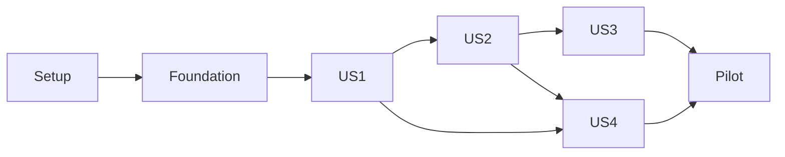

# Tasks: Business Operations Platform

**Input**: [Spec](spec.md), [plan](plan.md), [research](research.md), [data model](data-model.md), [contracts](contracts/), and [pilot validation guide](quickstart.md).

Paths are relative to the repository root. Paths introduced by these tasks are proposed implementation locations. A `[P]` task can run alongside the tasks named in the parallel examples once its prerequisites are ready. The checkpoints exercise the acceptance scenarios in the spec. The optional Temporal branch is part of a single task so either verified execution path can complete it.

## Phase 1: Setup

**Purpose**: Establish the current baseline and record evidence for the reuse decisions.

- [X] T001 Run `npm run check` from `package.json`, check the pinned OpenBot build and Compose startup from `deploy/openbot/upstream.json` and `docker-compose.yml`, and record the exact revision, supported chat and tool hooks, AG-UI package version, and any blocked runtime checks in `specs/001-business-operations-platform/research.md`.
- [X] T002 [P] Run the host Lima probe from `specs/001-business-operations-platform/quickstart.md`, verify guest persistence and reachability from Compose on the target host, and record the verified host profile and guest image digest in `deploy/workspace-provider/README.md`.
- [X] T003 Use a minimal disposable workflow probe to evaluate native OpenBot orchestration for a persisted decision wait and an interrupted effect under SC-014. Evaluate the pinned Intelligence requirement and licensing under DC-003. Record the reuse decision, exact observed gaps, and supported pilot dependencies in `specs/001-business-operations-platform/research.md` after T001. Keep integration checks open when a runnable host or required configuration is unavailable.

## Phase 2: Foundation

**Purpose**: Provide the shared blueprint, installation, project identity, and permission boundaries.

- [X] T004 [P] Extend `schemas/blueprint.schema.json` and `src/types.ts` for roles, initialization checks, artifact schemas, action results, workflow definitions, and role views per `specs/001-business-operations-platform/contracts/blueprint-workflow.md`. Preserve compatibility with existing blueprint files.
- [X] T005 [P] Define the installation, immutable blueprint version, project membership, assignment, conversation, and artifact tables in `deploy/openbot/product/migrations/001-projects.sql`. Use project-qualified references and generate project IDs independently of source paths.
- [X] T006 [P] Implement the planned `blueprint provision` command in `bin/blueprint.ts` and blueprint-keyed deployment in `bin/openbot-compose.ts` and `docker-compose.yml`. Serialize creation, identify the existing deployment on repeat, and allocate distinct app ports, data, network, and VM namespaces for distinct keys. Retain the installed key across version upgrades and preserve native environment preflight.
- [X] T007 Implement semantic validation in `src/schema.ts` and publication/export in `src/blueprints.ts` and `bin/blueprint.ts` using T004 and T005. Enforce publisher authorization and reject unresolved references, unreachable terminal outcomes, overlapping transition conditions, and changed content under a published key/version. Preserve CLI validation and tenant export.
- [ ] T008 Implement authenticated project lookup, membership checks, permission-filtered artifact resolution, structured errors, and mutation idempotency in `deploy/openbot/product/access.ts` and `deploy/openbot/product/store.ts` using T005. Derive project and actor from native context, including bot callbacks.
- [ ] T009 Integrate the product module with the pinned server, migrations, and governed tool path in `deploy/openbot/team-intake/install.ts` and `deploy/openbot/server.Dockerfile` after T007–T008. Preserve the existing chat and tenant entry points.

**Checkpoint**: Invalid blueprints fail publication. A blueprint key resolves to one installation. Shared data access goes through authenticated project scope.

## Phase 3: US1 — Provision and initialize a business (P1)

**Goal**: Create a SWE project with its own team, source baseline, and VM. Show what must be fixed before it can operate.

**Independent validation**: Create a project from an accessible local folder. Introduce a missing or unusable prerequisite and verify that Team Lead remains available for setup while operational work is blocked. Correct the issue and verify that all mandatory artifacts, the VM, and current bot reports are ready before operations open. Use SC-001 and SC-006.

- [X] T010 [P] [US1] Define Team Lead, PM, Engineering, QA and Release Engineering as the SWE operating roster, with role views, skills, tools, startup checks, workspace requirement and typed artifacts in `blueprints/software-development/blueprint.json` and `blueprints/software-development/artifacts.json`. Make source required and let the owner add the recommended inputs in FR-002.
- [X] T011 [P] [US1] Implement authenticated Lima ensure, health, and reconciliation operations in `deploy/workspace-provider/lima.ts` and `deploy/workspace-provider/server.ts`. Use a stable installation and project key, persistent guest disk, and isolated network. Return a blocker on provider failure and recover the existing VM after an uncertain create.
- [X] T012 [P] [US1] Implement bounded read-only local folder intake in `deploy/workspace-provider/source-import.ts`. Revalidate containment, preserve the selected committed Git baseline or snapshot a plain folder, reject escaping references, and return the verified guest revision and digest without changing the source.
- [X] T013 [US1] Implement project creation, artifact submission, per-project VM binding, Team Lead conversation creation, and project listing in `deploy/openbot/product/projects.ts` and `deploy/openbot/product/migrations/002-initialization.sql` after T010–T012. Reconcile retries using existing project and VM identities.
- [ ] T014 [US1] Implement the guest action and reconciliation operations in `deploy/workspace-provider/actions.ts` and bind them to native role and tool grants in `deploy/openbot/product/workspace.ts` after T011 and T013. Match actor, project, assignment, and VM before dispatch. Hold dependent work when the VM is unavailable.
- [ ] T015 [US1] Implement per-assignment readiness checks, persisted evidence and invalidation in `deploy/openbot/product/readiness.ts` after T013–T014. Invalidate affected reports when inputs or assignments change. Block operational handoffs, execution and release until every required check is current and ready.
- [ ] T016 [US1] Implement `GET/POST /api/products` and `POST /api/products/:id/initialization` in `deploy/openbot/product/routes.ts` after T015. Return scoped setup reports, VM status and retryable blockers.
- [ ] T017 [US1] Update the Projects page, folder selection and Team Lead setup experience in `deploy/openbot/team-intake/projects-route.tsx` and `deploy/openbot/team-intake/setup-form.tsx` after T016. Show the pinned version, role roster, mandatory and recommended inputs, progress and targeted setup questions.
- [ ] T018 [US1] Backfill legacy owner/source conversation groups with stable project IDs in `deploy/openbot/product/migrations/003-legacy-projects.sql` and switch existing project-linked chats in `deploy/openbot/team-intake/setup-store.ts` after T016. Verify existing associations before switching writes and preserve independent identity for new same-folder projects.
- [ ] T019 [US1] Run the setup acceptance scenarios in `specs/001-business-operations-platform/quickstart.md` after T017–T018, including a VM provisioning retry, missing and stale bot reports, and the timed owner setup check. Record evidence against SC-001 and SC-006.

## Phase 4: US2 — Work through the product’s Team Lead (P1)

**Goal**: Turn a user’s requested outcome into an observable workflow with decisions, governed handoffs, verification, and role-specific views.

**Independent validation**: Start with one Operational project. Ask for an adoption recommendation, a feature, and a clear outcome with no published match. Verify selection and temporary planning, pause and resume a decision, follow live QA and its final result, and confirm scoped bot feedback survives restart. Use SC-002, SC-007, and SC-009–014.

- [X] T020 [P] [US2] Declare SWE discovery and feature delivery workflows, matching conditions, phase owners, retry rules, and mandatory release phase references in `blueprints/software-development/workflows.json`. Define the Change Brief, Candidate, Test Plan and QA Evidence contracts in `blueprints/software-development/artifacts.json` after T010.
- [X] T021 [P] [US2] Add work items, pinned run plans, attempts, transitions, pending decisions, dispatch intent and effect identities in `deploy/openbot/product/migrations/004-workflow.sql` after T005. Uniquely identify a phase occurrence and its stable operation key across retries.
- [ ] T022 [P] [US2] Implement scoped bot feedback and correction history in `deploy/openbot/product/feedback.ts` and `deploy/openbot/product/migrations/005-feedback.sql` after T008. Reuse native assignment memory if it meets SC-011. Otherwise use the existing PostgreSQL store. Inject current authorized guidance alongside configured skills and MCP without changing permissions or workflow rules.
- [ ] T023 [US2] Implement Team Lead routing and clarification in `deploy/openbot/product/workflow-routing.ts` after T020–T021. Prefer the matching published workflow. Persist a validated temporary workflow with guidance references when no match fits, and explain unresolved inputs or permissions without changing the catalog.
- [ ] T024 [US2] Implement the shared execution interface in `deploy/openbot/product/workflow-engine.ts` after T003 and T021. Use the native path if it meets SC-014. Otherwise wire the private Temporal service and worker in `deploy/workflow/worker.ts` and `deploy/workflow/compose.yml`. Support persisted waits, deduplicated dispatch, correlated attempts, and restart on the pinned run plan.
- [ ] T025 [US2] Implement typed bot requests and result acceptance in `deploy/openbot/product/actions.ts` after T023–T024. Recheck grants, readiness, artifact revisions, expected phase and attempt identity before transitions. Record invalid or stale outputs and make repeated results idempotent.
- [ ] T026 [US2] Implement the PM brief and Engineering candidate handoffs in `deploy/openbot/product/feature-delivery.ts` after T025. Ask for consequential missing decisions, run authorized implementation in the assigned VM, and bind each candidate to the exact brief and source baseline.
- [ ] T027 [US2] Implement Test Plan and QA execution in `deploy/openbot/product/qa.ts` after T026. Persist scenario progress, validate every final result and its references, compute pass counts, and transition to rework, a wait, or verified according to the evidence.
- [ ] T028 [US2] Implement work item create/read, decision resume, and assignment feedback routes in `deploy/openbot/product/work-routes.ts` after T022 and T025. Return attempts, blockers and timestamps to authorized actors and signal the same run on an authorized decision.
- [ ] T029 [US2] Implement authorized AG-UI snapshots and deltas in `deploy/openbot/product/chat-state.ts` after T027–T028. Filter each viewer’s state before generating deltas, recheck on reconnect or permission change, and bind updates to the original conversation and run.
- [ ] T030 [US2] Mount blueprint-selected role views in the originating chat via `deploy/openbot/team-intake/install.ts` and render expandable QA scenarios, live progress, and the final verdict in `deploy/openbot/team-intake/domain-views.tsx` after T029. Reuse compatible native rendering and reload the same final evidence when the conversation is reopened.
- [ ] T031 [US2] Run the workflow, handoff, QA, feedback and reconnect scenarios in `specs/001-business-operations-platform/quickstart.md` after T030. Validate recoverable retries and persisted decision waits on both published and temporary runs using a disposable effect fixture. Repeat the actual staging-effect proof in US3.

## Phase 5: US3 — Prepare and approve a release (P2)

**Goal**: Prepare a release with exact evidence, ask the designated human approver, and deploy once to a disposable target.

**Independent validation**: Begin from a verified candidate. Check that missing artifacts or stale evidence hold release, then approve the exact candidate and target and inspect its verified receipt. Interrupt the worker after the target accepts the deployment and confirm recovery leaves one outcome. Use SC-003, SC-005, and SC-014.

- [X] T032 [P] [US3] Add release proposals, candidate/target-bound approvals and effect receipts in `deploy/openbot/product/migrations/006-releases.sql` after T021. Persist the operation key and verification references.
- [X] T033 [P] [US3] Implement the disposable staging target adapter with lookup and reconciliation by operation ID in `deploy/openbot/product/staging-target.ts` after T024. Support a pilot fixture that commits the effect before its receipt is returned. The adapter and durable disposable fixture are verified independently; connecting approval and workflow execution remains T034–T036.
- [ ] T034 [US3] Implement release preparation, authorized approval, stale evidence invalidation, deployment, and post-deployment verification in `deploy/openbot/product/releases.ts` after T027, T028, T032 and T033. Recheck approval before effect dispatch. Reconcile an uncertain result before retrying.
- [ ] T035 [US3] Wire Release Engineering and Team Lead summaries into the SWE release phases in `blueprints/software-development/workflows.json` and `deploy/openbot/team-intake/domain-views.tsx` after T030 and T034. Show the approver the candidate, target, evidence and decision. Report the verified outcome in the originating conversation.
- [ ] T036 [US3] Execute the release and recovery scenarios in `specs/001-business-operations-platform/quickstart.md` after T035. Verify each negative release gate and a single staging outcome for the published and temporary workflow interruption scenarios.

## Phase 6: US4 — Reuse blueprints across independent products (P2)

**Goal**: Run multiple isolated projects in one blueprint app and a separate installation for a distinct blueprint.

**Independent validation**: Create two SWE projects from one folder, provision the SWE key again, publish a new SWE version, and start a distinct blueprint on another endpoint. Verify isolation, version pinning, archive behavior and independent app lifecycle. Use SC-004 and SC-008.

- [ ] T037 [P] [US4] Define a distinct blueprint fixture with its own roster, typed artifact and one runnable workflow in `test/fixtures/blueprints/distinct-business/blueprint.json` after T007. Exercise the same publication and tenant export path.
- [X] T038 [P] [US4] Implement archive authorization and preservation of conversation, artifact, and run history in `deploy/openbot/product/archive.ts` after T013. Prevent new work on archived projects at request acceptance and dispatch.
- [ ] T039 [US4] Integrate `POST /api/products/:id/archive` and the archive action in `deploy/openbot/product/routes.ts` and `deploy/openbot/team-intake/team-projects.tsx` after T017 and T038. Keep history available to authorized viewers and preserve each project’s pinned blueprint version.
- [ ] T040 [US4] Run the concurrent installation and same-folder project scenarios in `specs/001-business-operations-platform/quickstart.md` after T006, T019, T031, T037 and T039. Verify a second blueprint runs through the shared implementation, duplicate SWE provisioning resolves the existing app, cross-project access is refused, and restarting one app leaves the other available.

## Phase 7: Polish and pilot validation

- [X] T041 [P] Update `docs/docker-compose.md` and `README.md` with the supported provision command, pinned runtime dependencies, host VM setup and recovery, and the native or selected fallback execution path.
- [ ] T042 [P] Restore a backup of the pilot project database, artifact data, and selected engine state into a disposable stack. Record the procedure and evidence in `specs/001-business-operations-platform/pilot-results.md`. Confirm VM bindings reconcile and uncertain effects remain held pending reconciliation.
- [ ] T043 Run `npm run check`, the pinned integration build, and the complete acceptance guide in `specs/001-business-operations-platform/quickstart.md`. Record results and gaps against SC-001–014 and DC-001–006 in `specs/001-business-operations-platform/pilot-results.md`.
- [ ] T044 Add explicitly authorized dependency egress for project workspaces while retaining the default-deny namespace policy. Verify permitted dependencies are reachable and host control planes, sibling VMs, and unapproved destinations remain inaccessible on each supported host profile. The current provider intentionally denies all outbound network access.

## Dependencies and execution order

- T001–T003 establish the reuse and platform evidence. T002 can proceed independently of T001. Runtime validation requires a runnable host.
- After setup, T004–T006 can proceed together. T007 and T008 use the shared contracts and schema and converge at T009.
- US2 needs an Operational project from US1. US3 needs a verified candidate and the execution interface from US2. US4 can prepare its fixture and archive path early. Its full checkpoint needs US2 execution for the distinct blueprint and can run alongside US3.
- Phase 7 follows the story checkpoints. T043 follows T041–T042 and T044.

### Parallel examples

| Story | Independent work after prerequisites |
| --- | --- |
| US1 | T010 defines the blueprint while T011 implements VM lifecycle and T012 implements bounded source import. Integrate them in T013. |
| US2 | T020 defines the workflows, T021 adds durable run storage, and T022 handles project-scoped feedback in separate files. |
| US3 | T032 implements approval and effect storage while T033 implements staging operations. T034 uses both. |
| US4 | T037 prepares the distinct blueprint fixture while T038 implements archive behavior. T039 integrates archive into the app. |

## Implementation strategy

**MVP** — Complete setup, foundation and US1. Demonstrate one initialized SWE project, its own persistent VM, and visible readiness blockers before operations open.

Add Team Lead execution and QA through US2. Add human-approved staging delivery through US3. Validate concurrent projects, blueprint reuse, and independent installations through US4 before the full pilot.

## Requirement traceability

| Spec scope | Task coverage |
| --- | --- |
| FR-001, FR-004, FR-016, FR-020–021, FR-026, FR-034 | T004, T007, T010, T020, T025, T037, T040 |
| FR-002–003, FR-005, FR-015, FR-017–019 | T005, T008, T013, T015–T019, T038–T040 |
| FR-022–024 | T002, T011–T015, T019, T040, T042 |
| FR-006–009, FR-011, FR-025, FR-027, FR-035–036 | T015–T017, T021, T023–T028, T031, T034, T036 |
| FR-010, FR-012–014, FR-028 | T026–T027, T032–T036 |
| FR-029–031 | T022, T028, T031 |
| FR-032–033 | T029–T031, T035 |
| DC-001–006 | T001–T003, T006, T009, T024, T029, T040–T043 |
